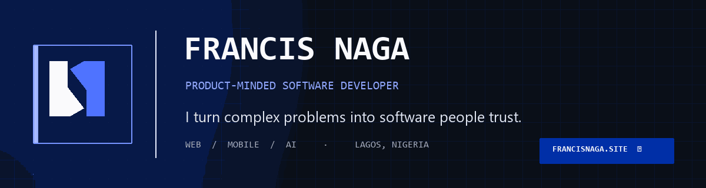

<div align="center">
  <a href="https://francisnaga.site/">
    
  </a>

  <h1>Francis Naga · Product-minded software developer</h1>

  <p><strong>I turn complex problems into software people trust.</strong><br />
  Web products, mobile apps, and practical AI — from a clear idea to a polished release.</p>

  <p>
    <a href="https://francisnaga.site/"></a>
    <a href="https://github.com/francisnaga"></a>
    <a href="mailto:hello@francisnaga.site"></a>
    <a href="https://www.linkedin.com/in/francisnaga/"></a>
  </p>

  <p>
    
    
    
    
  </p>

  <p><a href="#selected-work">Selected work</a> · <a href="#inside-the-build">Inside the build</a> · <a href="#run-locally">Run locally</a> · <a href="#connect">Connect</a></p>
</div>

---

## The portfolio

This repository powers [francisnaga.site](https://francisnaga.site/), the personal portfolio of **Efobi Francis Chibundo (Naga)** — a product-minded software developer based in Lagos, Nigeria, and a Marine Engineering student at Nigeria Maritime University.

The site is designed for two conversations: joining a thoughtful engineering team, or helping a founder turn a product idea into a dependable release. It leads with selected work, explains the engineering behind it, and makes the next step clear.

## Selected work

| Product | What it does | Explore |
| --- | --- | --- |
| **NCB Finance** | Invoicing and payments for Nigerian freelancers and businesses. | [Source](https://github.com/francisnaga/NCB-Finance) |
| **Vantage** | A focused workspace for moving job applications from shortlist to offer. | [Source](https://github.com/francisnaga/Vantage) |
| **NairaLens** | Financial product, remittance-rate, and provider comparison tools. | [Source](https://github.com/francisnaga/NairaLens) |
| **Classync** | A student-first campus PWA with role-based approvals. | [Source](https://github.com/francisnaga/Classync) |
| **Inkto** | Mobile legal-document scanning, transcription, and DOCX output. | [Google Play developer page](https://play.google.com/store/apps/dev?id=7500831168663512287) |

> **Preview note:** The NCB Finance, Vantage, NairaLens, and Classync subdomains currently have missing DNS records. Their project dialogs link to source code while those preview domains are repaired.

## Inside the build

- **Clear product story:** the hero, project details, background, and contact paths speak to both hiring teams and product partners.
- **Useful project evidence:** each project includes its purpose, stack, and a concise architecture summary.
- **Real public GitHub activity:** the site fetches repository, star, and follower counts from GitHub's public API. It caches the response in the visitor's browser for 15 minutes and shows saved data if GitHub is unavailable.
- **Accessible interactions:** responsive navigation, keyboard-operable project dialogs, Escape close, focus handling, and reduced-motion support.
- **Personal brand system:** a custom two-tone monogram, International Klein Blue accents, and a clean technical visual language.
- **Built for static deployment:** Vite outputs the production site to `dist/`, with Vercel configuration included.

GitHub profile figures describe public repository activity. They are not portfolio visits, customer counts, revenue, or app installs. The site does not collect visitor analytics.

## The stack

<p>
  
  
  
  
  
  
</p>

The GitHub stats cards below are generated by [GitHub Readme Stats](https://github.com/anuraghazra/github-readme-stats). They summarize public GitHub activity, can be cached, and do not measure site traffic or hiring interest.

<div align="center">
  
  
</div>

## Run locally

Requires Node.js `20.19+` or `22.12+` and npm.

```bash
git clone https://github.com/francisnaga/My-Portfolio.git
cd My-Portfolio
npm ci
npm run dev
```

Vite prints the local development URL after the server starts.

| Command | Purpose |
| --- | --- |
| `npm run dev` | Start the development server. |
| `npm run build` | Build the production site in `dist/`. |
| `npm run preview` | Preview the production build locally. |
| `npm run lint` | Check source with Oxlint. |

## Brand assets

- `assets/readme-banner.gif` — original, restrained animated README banner; regenerate with `python scripts/generate_readme_banner.py`.
- `public/logo.svg` and `public/logo-white.svg` — two-tone and white Naga marks.
- `public/favicon.svg` — browser icon with a dark-mode color variant.
- `public/og-image.png` — social-sharing preview image.
- `src/components/Logo.jsx` — reusable React mark.

## Connect

- **Website:** [francisnaga.site](https://francisnaga.site/)
- **Email:** [hello@francisnaga.site](mailto:hello@francisnaga.site)
- **GitHub:** [github.com/francisnaga](https://github.com/francisnaga)
- **LinkedIn:** [linkedin.com/in/francisnaga](https://www.linkedin.com/in/francisnaga/)

The repository has no license file. Please contact the author before reusing the source or brand assets.
